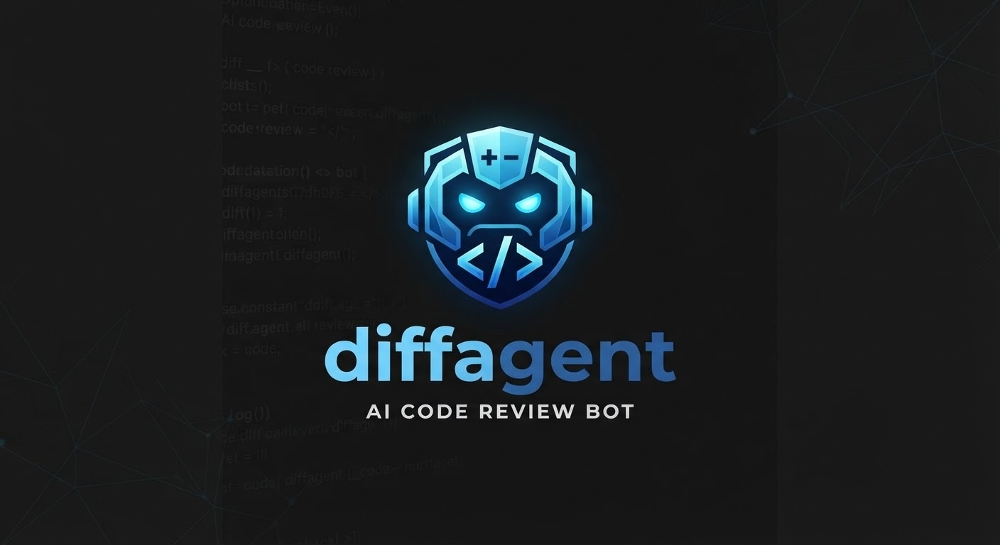

<p align="center"></p>

<p align="center">
  <a href="https://github.com/thiszona/diffagent/actions/workflows/rust.yml"></a>
  <a href="https://qlty.sh/gh/thiszona/projects/diffagent"></a>
  <a href="https://qlty.sh/gh/thiszona/projects/diffagent"></a>
</p>

diffagent is a GitHub App that reviews pull requests, answers questions in its review
threads, and learns per-repo rules from Maintainer corrections. You run it under your own
GitHub App, with your own Postgres and your own model routes. It is written in Rust.

- Reviews changed files in Go, TypeScript, JavaScript, Python, Java, Kotlin, C#, PHP,
  Ruby, Rust, Swift, C, C++ and Scala, with cross-file context for Go and TS/JS, and
  comments inline on the diff.
- Posts a Walkthrough of each pull request, with a Ticket fit when the PR names a Jira
  issue.
- Closes a Finding when a later push fixes it.
- Answers questions in its review threads, in English or Indonesian.
- Learns a Lesson for the repo when a Maintainer rejects a Finding with a reason: it
  proposes the rule in the Thread, and stores it once a Maintainer confirms with `learn`.
- Can block merges while a critical Finding is open, through a required check run.
- Runs on Bedrock, Anthropic or any OpenAI-compatible API, with a model per role.

## Quick start

Create a GitHub App and install it on the repositories to review, as described in
[Install a GitHub App](docs/setup.md#install-a-github-app). Then run the image from
GitHub Container Registry:

```sh
docker run --rm -p 8080:8080 \
  -e GITHUB_WEBHOOK_SECRET='<webhook secret>' \
  -e GITHUB_APP_ID=123456 \
  -e GITHUB_APP_PRIVATE_KEY="$(cat your-app.private-key.pem)" \
  -e DATABASE_URL='postgres://diffagent:<password>@db.example.com:5432/diffagent' \
  -e AWS_REGION=us-east-1 -e AWS_BEARER_TOKEN_BEDROCK='<Bedrock API key>' \
  ghcr.io/thiszona/diffagent:v0.1.0
```

That calls the default models on Bedrock. Any AWS SDK credential source works in place of
`AWS_BEARER_TOKEN_BEDROCK`. To use another provider, set the model routes, for example
`-e REVIEW_MODEL=anthropic/claude-haiku-4-5 -e ANTHROPIC_API_KEY=...`. See
[Configuration](docs/configuration.md) for every setting.

To try it from source without an App, run it in [dev mode](docs/setup.md#run):

```sh
GITHUB_WEBHOOK_SECRET=dev cargo run --bin diffagent
```

## Commands

Write `@<your-app-slug> <command>` at the start of a line in a PR comment. The handle is
your App's slug, read from GitHub at startup (`@diffagent` in dev mode).

| Command | What it does | Who |
|---|---|---|
| `review` | Review the current head again, and unpause the PR. Skipped when a later `review` from its sender or the PR's author is queued, or a Review of the head completed after it was posted | the PR's author or a Maintainer |
| `pause` | Stop automatic Reviews until the next `review` | Maintainer |
| `resolve` | Close every Finding open when the comment was posted | Maintainer |
| `lessons` | List the repo's active Lessons | Maintainer |
| `forget N` | Remove Lesson `N`; a bare `forget` in a Thread removes that Thread's Lesson | Maintainer |
| `learn` | In a Thread, store the Lesson the bot proposed there and suppress its Finding; a bare `learn` reply works too | Maintainer |
| `close` | In a Thread, close its Finding with no Lesson (never a critical one; `forget` reopens it); a bare `close` reply works too | Maintainer |

A Maintainer is anyone with write or admin on the repo, except, on a PR, its author and
anyone who pushed to it (the sender of its `opened`, `reopened` and `synchronize` events):
nobody dismisses a Finding in code they pushed.

## Documentation

- [Setup](docs/setup.md): the GitHub App, running the service, and deploying the image.
- [Configuration](docs/configuration.md): every environment variable, model providers and data residency.
- [Merge gate](docs/merge-gate.md): a required check that blocks merges on critical Findings.
- [Jira](docs/jira.md): ticket intent and the Ticket fit.
- [How it works](docs/how-it-works.md): the pipeline, Reviews, Threads, Lessons and languages.
- [Eval](eval/README.md): scoring reviews against labeled problems.
- [Glossary](GLOSSARY.md): the terms these docs use.

## Contributing

See [CONTRIBUTING.md](CONTRIBUTING.md).

## License

diffagent is licensed under the Apache License 2.0. See [LICENSE](LICENSE).
