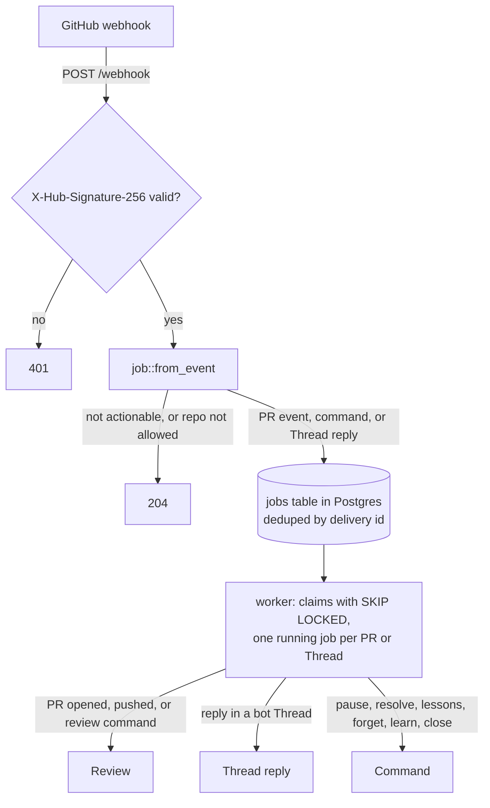
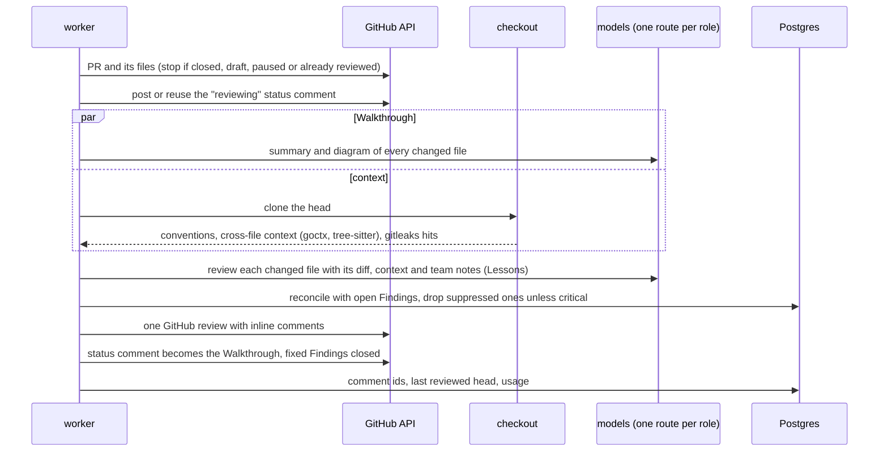
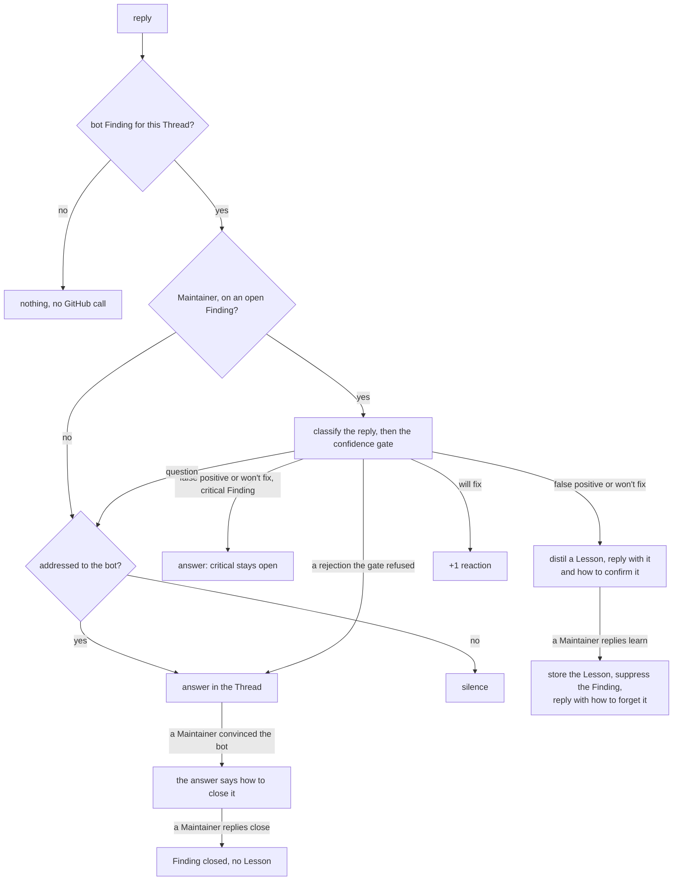

# How it works

## Pipeline

Every delivery is verified, queued in Postgres, and run by a worker. Delivery is at least
once; each effect on GitHub happens once.

## Reviews

A pull request is reviewed when it is opened, reopened or marked ready, and 30 s after
each push. Drafts wait until they are ready.

A Review posts a Walkthrough, with a diagram when the model draws one, and inline comments
anchored to the diff. Findings fixed by a later push are closed. With [Jira](jira.md)
configured, the Walkthrough also has a Ticket fit.

The model reviews changed files in these languages, leaving out tests and generated or
vendored code:

| Language | Extensions | Cross-file context |
|---|---|---|
| Go | `.go` | type-checked, through `diffagent-goctx` |
| TypeScript, JavaScript | `.ts`, `.tsx`, `.mts`, `.cts`, `.js`, `.jsx`, `.mjs`, `.cjs` | tree-sitter, following imports |
| Python | `.py` | none |
| Java, Kotlin, Scala | `.java`, `.kt`, `.kts`, `.scala`, `.sc` | none |
| C# | `.cs` | none |
| PHP, Ruby | `.php`, `.rb`, `.rake` | none |
| Rust, Swift | `.rs`, `.swift` | none |
| C, C++ | `.c`, `.h`, `.cc`, `.cpp`, `.cxx`, `.hh`, `.hpp`, `.hxx` | none |

A file without cross-file context is reviewed from its diff alone. Every
language gets the same Finding identity (the enclosing function or method) and the same
check that a suggestion still parses. A file in any other language is not reviewed.

A minor or nitpick Finding is commented on once. Found again after its comment was closed
or deleted, it is tracked but not posted again.

## Threads and Lessons

A [Maintainer](../README.md#commands)'s reply in a Thread on one of the bot's open
Findings is classified, mention or not, as a question, false positive, won't fix or will
fix. Few replies mention the bot, so waiting for a mention would leave most corrections
unlearned.

A confident false positive or won't fix with a stated reason proposes a Lesson: the bot
replies with the rule it would learn and where it applies, and stores nothing yet. The
reason must be the Maintainer's own: the classifier also reads the Finding, whose text
the PR's author shaped, so at least a third of the reason's content words must come from
the reply (a word matches on its first five letters, so `migrasi` matches `migration`).
A rejection with any other reason is answered instead.

The same Finding text can still steer the classifier to read a question as a rejection
in the Maintainer's own words, so a proposal waits for a Maintainer's `learn` reply in
that Thread. Any Maintainer may confirm it, not only the one who replied, but never the
PR's author or anyone who pushed to it. `learn` stores the Lesson, which later Reviews of
the repo read, with the confirming Maintainer as its author, suppresses the Finding and
replies with how to forget it. The proposal lives in a hidden marker of the bot's own
reply, and `learn` takes it only when the rule and scope in the marker are the ones the
reply shows and its class and confidence are ones the gate believes, so an edit to the
reply cannot store a rule other than the one a Maintainer read. A `learn` with no
proposal waiting, after a confirmed one or a `forget`, says so and changes nothing.
Critical Findings are never suppressed automatically, and a suppressed Finding a later
Review finds critical is open again.

An answer to a Maintainer can concede that the Finding does not hold. The answer model
reads the Finding too, so a concession changes nothing: the answer ends with how to close
the Finding, and a Maintainer's `close` reply in that Thread suppresses it with no Lesson.
`close` needs no concession and calls no model. As with `learn`, the PR's author and
anyone who pushed to it cannot use it, it never closes a critical Finding, and `forget`
in the Thread reopens it. A second `close` changes nothing. `resolve` is the PR-wide
form.

Anyone else's reply is answered when it is addressed to the bot, and changes nothing. A
reply is addressed to the bot when it mentions the bot, or when it mentions no one else
and is shaped as a question: it holds a `?`, or opens with an English question word
(`why`, `what`, `how`, `when`, `which`, `who`, `where`, `is`, `are`, `can`, `does`), an
Indonesian one (`apa`, `apakah`, `kenapa`, `mengapa`, `kok`, `gimana`, `bagaimana`,
`emang`, `kapan`, `siapa`, `mana`, `dimana`, `berapa`, `jelasin`, `jelaskan`), or the two
words `di mana`, `tolong jelas`, `minta tolong`, `bantu jelas` or `coba jelas`.

The bot replies at most ten times in one Thread, so a Thread's cost stays bounded. GitHub
lists only the first 3,000 review comments of a PR, so on a PR with more the bot cannot
count its replies and treats each of its Threads there as full.

## Languages

Thread replies follow the language of the comment they answer, English or Indonesian. An
answer is written in the reply's language, and a Lesson's rule in the language of the
Maintainer's reason.

The bot's fixed notes in a Thread (a proposed Lesson and how to confirm it, a suppression
and how to undo it, a critical that stays open, how to close a Finding, a closed Finding)
come in English and Indonesian. `learn` replies in the language of the proposal it
confirms, and `close` in English. A reply whose prose, code in
backticks aside, holds two or more distinct common Indonesian words gets the Indonesian
note; any other gets the English one.

Command notes (`pause`, `resolve`, `lessons`, `forget`, `learn` with nothing to confirm,
`close`, and "Maintainers only") are in English. A Ticket fit is written in the Jira issue's language.
